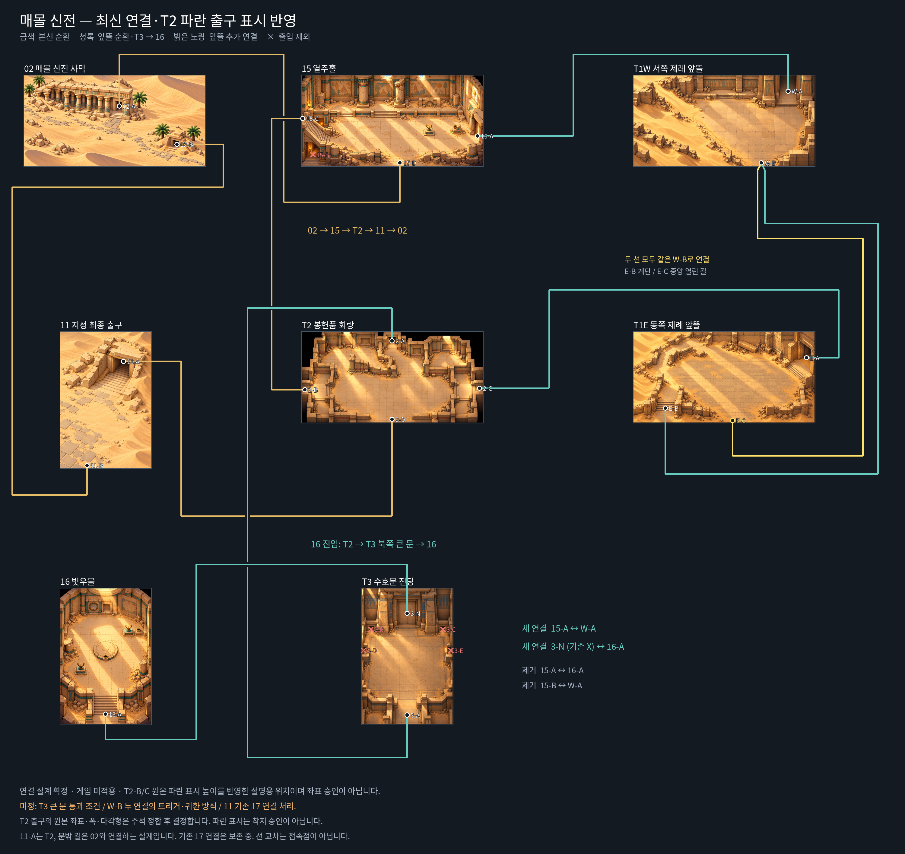

# 신전 연결 — 2026-10-19 최신 사용자 결정

이 문서는 **새 연결 설계의 기준**이다. 게임 적용 완료 보고가 아니다. 사용자 최신 도안과 문서 정합화 요청에 따라 기존 신전 순서를 대체한다. 원본 PNG·수동 충돌·생성 프롬프트·피라미드 연결·다른 사막 구간은 변경하지 않는다.

[정리 지도 원본](consult/desert/temple-route-2026-10-19/route.png) · [공통 출입구 기준](OPUS-MAPS.md) · [구현 인수인계](DESERT-OPUS-HANDOFF.md) · [공간 등록표](DESERT-REGISTRY.md)

지도는 Library `libfile_eb66a703a50c8191aa64b7f617583811`로 전달한 정리본의 연결 관계를 유지하고, 후속 사용자 파란 출구 표시를 반영해 T2-B/C 설명용 원만 아래쪽으로 옮겼다. 원본 맵 그림은 바꾸지 않았다. 금색은 본선 순환, 청록은 앞뜰 순환과 T3→16, 밝은 노랑은 앞뜰 추가 연결이다. 선 교차는 접속점이 아니다. 앞선 지도 제작 당시에는 ‘도안/11 해석 대기’였으나, 이번 문서 요청에서는 **아래 10개 연결의 공간 대응을 확정 기준으로 전달받았다**. 미정인 구현 방식은 별도로 남긴다.

## 확정 연결표

아래 문 번호는 **그림에서 구분하는 검토용 번호**이며 runtime `exit.id`·`entries` 이름이나 트리거 좌표가 아니다. `↔`는 동일 경로의 왕복이다. 방향 화살표가 있는 본선 설명도 일방통행을 뜻하지 않는다.

| 번호 | 출입구 A | 출입구 B | 역할 |
|---|---|---|---|
| 1 | 02-A 큰 신전문 | 15-D 남쪽 열린 입구 | 본선 진입 |
| 2 | 15-C 왼쪽 위 사선 계단 끝 | T2-B 왼쪽 횡통로 | 본선 |
| 3 | T2-D 남쪽 열린 출구 | 11-A 계단 위 석문 | 본선 최종 출구 |
| 4 | 11 문밖 석재길 | 02-B 작은 매몰입구 | 본선 귀환 |
| 5 | 15-A 오른쪽 문 | T1W-A 북동쪽 큰 문 | 앞뜰 순환 |
| 6 | T2-C 오른쪽 횡통로 | T1E-A 오른쪽 문 | 앞뜰 순환 |
| 7 | T1E-B 왼쪽 아래 계단 | T1W-B 남쪽 열린 길 | 앞뜰 기존 연결 |
| 8 | T1E-C 남쪽 중앙 열린 길 | 같은 T1W-B 남쪽 열린 길 | 앞뜰 추가 연결, 7과 모두 유지 |
| 9 | T2-A 북쪽 문 | T3-A 남쪽 통로 | 16으로 가는 경로 |
| 10 | T3 북쪽 큰 문(지도 3-N, 이전 X) | 16-A 남쪽 계단 | 16 진입·귀환 |

- **본선 순환:** 02 → 15 → T2 → 11 → 02.
- **앞뜰 순환:** 15 → T1W → T1E → T2 → 15. T1E↔T1W는 서로 다른 E-B·E-C를 쓰는 **두 연결**이다. 하나를 지우거나 다른 W 문으로 옮기지 않는다.
- **빛우물 접근:** 15에서 16으로 바로 가지 않는다. 15 → T2 → T3 → 16이며, T3 남쪽으로 T2에 되돌아올 수 있어야 한다. 공간 경로 확정이 보스 필수 처치·문 자동 개방을 승인한 것은 아니다.

## 그림별 출입구와 제외 지점

| 그림 / 의미 ID | 최신 대응 | 비고 |
|---|---|---|
| 02 `desert_buried_temple` | A→15-D, B→11 문밖 길 | 기존 03·10 등 신전 밖 관계는 이번 변경 대상 아님 |
| 15 `desert_colonnade` | A→T1W-A, C→T2-B, D→02-A | **B 왼쪽 아래 입구는 출입 제외**. C는 뒤 횃불 벽면이 아니라 실제 계단의 왼쪽 위 끝 |
| T1W `desert_forecourt_west` | A→15-A, B→T1E-B 및 T1E-C | 넓은 B의 두 경로 처리 방식은 미정 |
| T1E `desert_forecourt_east` | A→T2-C, B→T1W-B, C→T1W-B | B와 C를 한 출구로 합치지 않음 |
| T2 `desert_votive_hall` | A→T3-A, B→15-C, C→T1E-A, D→11-A | 남쪽 D는 열린 바닥 경계이며 연결 대상으로 사용자 지정됨 |
| T3 `desert_guardian_gate` | A→T2-A, 북쪽 큰 문→16-A | **양옆 작은 네 구멍 출입 제외**. 북쪽 큰 문을 제외하던 옛 지시는 최신 지정으로 대체됨 |
| 16 `desert_lightwell` | A→T3 북쪽 큰 문 | 위쪽 보상 벽감은 새 출구로 만들지 않음 |
| 11 `desert_city_gate` | A→T2-D, 문밖 길→02-B | 기존 A→17과 충돌: 아래 미결 사항 참조 |

채택 파일은 `사막맵/02_매몰신전사막.png`, `15_열주홀.png`, `T1W_서쪽제례앞뜰.png`, `T1E_동쪽제례앞뜰.png`, `T2_무너진봉헌품회랑.png`, `T3_신전수호문전당.png`, `16_빛우물.png`, `11_매몰도시출입구.png`다. 같은 이름의 수동 충돌은 `사막맵/충돌/`에 있다. 11 사용자 첨부와 저장소 원본은 1024×1536 RGBA 픽셀이 완전 동일함을 전달받았다(파일 인코딩 해시는 다름). 새 출구 그림을 만들지 않는다.

15-D·T2-D는 문틀이 없어도 실제 걸어나가는 열린 바닥 경계로 인정한다. 원본과 수동 충돌 가장자리 보행 영역을 확인했지만, 이것은 캐릭터 발 도형·동행·실제 왕복 시험 통과를 뜻하지 않는다. 수동 충돌 전체 폭을 그대로 출구 트리거로 복사하지 않는다.

## T2 좌우 출구 — 후속 파란 표시 우선

사용자 후속 지시: “출입구 디자인할 때 파란색 부분을 써 (이 맵 좌우 출입구 말야)”. 근거는 첨부 `1000484173.jpg`, Library `libfile_1898f51b3a688191b1e81f0d033f2d01`이다.

- 왼쪽·오른쪽 모두 기존 B/C 원보다 아래쪽, **측면 통로 바깥 가장자리와 계단 위쪽 평탄부 높이**에 표시했다. 기존 원의 위치로 출구를 고정하지 않는다.
- 대상은 계속 **T2-B↔15-C**, **T2-C↔T1E-A**다. 지도 원을 옮긴 것은 이 높이를 설명하기 위한 것으로 확정 좌표·트리거 다각형이 아니다.
- 부모가 실제 첨부에서 읽은 파란 중심 약 `(32,305)`·`(674,299)`, 썸네일 테두리 약 `(28,95)~(680,424)`는 **727×481 첨부 화면 좌표**다. 원본 맵 좌표로 저장하지 않는다. 실제 원본과 주석 이미지를 정합한 뒤 원본 좌표·통과 폭·투시 다각형을 정한다.
- 파란 출구 표시를 착지 위치 승인으로 확대 해석하지 않는다. 착지는 자연스러운 안쪽 길·발 도형·동행·전환 여유를 따로 확인한다. 이번 문서 갱신에서 runtime JSON·수동 충돌·착지는 변경하지 않았다.

## 폐기한 연결과 보존하는 기록

- 옛 `02↔T1W↔T1E↔15↔T2↔16` 선형 신전 계약은 위 연결표로 대체한다. 특히 W-A↔E-B, E-A↔15-A, T2↔16 직통을 최신 설계로 재사용하지 않는다.
- 중간 검토안의 **15-A↔16-A**, **15-B↔T1W-A**는 폐기한다. W-A↔11도 최신 연결에 없다.
- T3를 ‘16과 무관한 선택 종착지’, ‘뒤 큰 문은 출구 아님’으로 쓰던 공간 설명은 대체한다. 전투 수치·보상·처치 조건을 이 문서에서 바꾸지는 않는다.
- 과거 실행 결과·영상·생성 프롬프트는 당시 기록으로 보존한다. 그 안의 옛 그래프가 이 문서를 덮어쓰지 않는다. 피라미드 그래프는 그대로다.

## 아직 결정하지 않은 구현 사항

1. **T3 북쪽 큰 문 통과 조건:** 잠금·해제·보스 관계·귀환 조건은 미정. 닫힌 원본을 다시 그리거나 열림 이미지를 만들지 않는다. 새 연결만으로 문을 무조건 열지 않는다.
2. **T1W-B 두 길:** E-B와 E-C 연결 모두 보존한다. 겹치는 트리거에 독립 목적지를 임의 중첩하거나 하나를 삭제하지 않는다. 영역 분할·귀환 방향/기억 등 실제 방식은 정하지 않았다.
3. **11의 도시 연결 충돌:** 현재 `door`(계단 위 석문)는 17로 간다. 최신 설계의 T2 연결과 같은 물리 문을 사용하므로 17 외부 출입의 재연결 결정이 필요하다. **17 또는 기존 연결을 임의 삭제하지 않는다.** 11의 `left`·`bottom`은 문밖에서 같은 02-B로 귀환하는 두 경계다. 지도 11-B는 바깥길 대표점이지 신규 포털 좌표가 아니다.
4. **퍼즐·진행·저장:** 15의 기존 퍼즐 동작과 진행 기록을 보존한다. 16 메커니즘·필수 단서 접근·T3 잠금과 앞뜰 우회 가능성은 관련 담당자와 검토한다. 새 그래프를 이유로 퍼즐·진행 잠금을 우회하지 않는다.

## 현재 구현과 후속 검증

문서 작업 기준 main: `68da17c8413f41d31474468877bbc76318d7cc31` (2026-10-19 fetch 확인). 이 커밋의 JSON을 읽은 정적 확인이다. 사용자 설치본·실행 서버·별도 작업 브랜치의 완료 여부를 뜻하지 않는다.

| 기준 main 파일 상태 | 확인 내용 |
|---|---|
| 02 | `west→03/east`, `door→11/outside`; 새 15 연결 없음 |
| 11 | `left`·`bottom→02/door`, `door→17/east` |
| 15 / T1W | `exits: []`; 시험 착지 `east` / `yard` 존재 |
| T1E / T2 / T3 / 16 | 해당 맵 JSON이 기준 main에 없음 |

기존 맵 작업 브랜치의 구현·검증 커밋은 이 문서 브랜치에 포함하지 않는다. 새 연결을 적용 완료로 표시하거나 옛 시험 통과를 새 그래프의 증거로 재사용하지 않는다. 시험용 15 `east`·T1W `yard`, 기존 사용자 지정 착지와 안전구역 계약은 임의 삭제·이름 변경하지 않는다.

후속 구현은 [공통 맵 기준](OPUS-MAPS.md)에 따라 생성기에서 재현하고, 모든 연결의 실제 조이스틱 왕복·입력 유지 후 튕김 방지·의도적 재진입·발 도형·동행·카메라·저장/로드·충돌을 검사한다. 안전구역은 동일 이름의 착지와 짝 출구를 사용하는 기존 계약을 확인하며, 맵 연결 때문에 전투 스폰·공통 엔진을 무단 수정하지 않는다. 현재 문서 정합화에서는 런타임 시험·코드 변경을 수행하지 않는다.
