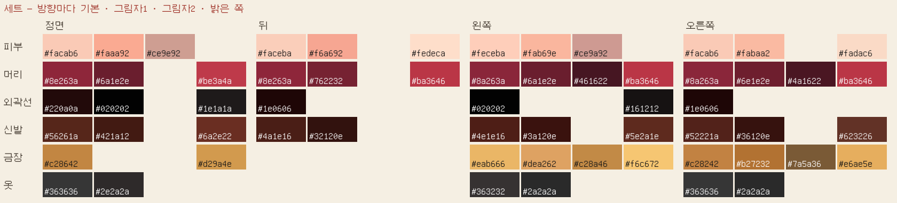
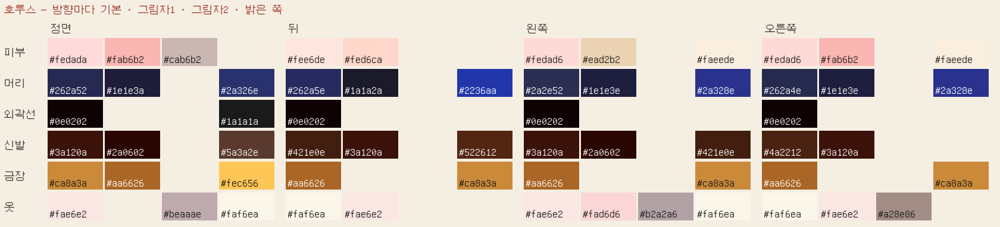
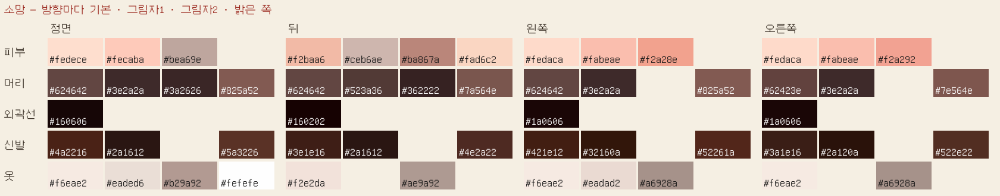

# 셋소호 색 표 — 최종 정지·걷기에서 뽑은 색

`python3 tools/art/palette.py`가 캐릭터·방향마다 최종 정지 1장 + 걷기 3장의 픽셀에서 만든다. **새 그림은 그리는 방향의 이 표 색만 쓴다.** 스포이트로 다시 뽑지 않는다. 누운 그림처럼 방향이 애매하면 정면 표. 표에 없는 단계가 필요하면 새로 만들지 말고 사용자에게 묻는다.

- 기본 = 가장 많이 쓴 색(평평한 면). 그림자 1 = 기본보다 조금 어두운 색, 그림자 2 = 더 어두운 색(외곽선 제외), 밝은 쪽 = 하이라이트.
- 괄호 안 % = 그 부위에서 그 색이 차지하는 비율. 작은 %는 작은 점·선에만 쓴다.
- 볼 홍조, 눈동자, 입, 리본처럼 작은 곳은 표에 없다. 그 방향 최종 정지에서 그대로 가져온다.
- 같은 캐릭터라도 방향마다 조금 다르게 칠해져 있다(채택본 그대로). 다른 방향 색을 섞지 않는다.

## 세트

**세트 정면**

| 부위 | 기본 | 그림자 1 | 그림자 2 | 밝은 쪽 |
|---|---|---|---|---|
| 피부 | `#facab6` (64%) | `#faaa92` (9%) | `#ce9e92` (3%) | — |
| 머리 | `#8e263a` (40%) | `#6a1e2e` (19%) | — | `#be3a4a` (2%) |
| 외곽선 | `#220a0a` (24%) | `#020202` (17%) | — | `#1e1a1a` (7%) |
| 신발 | `#56261a` (26%) | `#421a12` (24%) | — | `#6a2e22` (10%) |
| 금장 | `#c28642` (26%) | — | — | `#d29a4e` (22%) |
| 옷 | `#363636` (25%) | `#2e2a2a` (17%) | — | — |

**세트 뒤**

| 부위 | 기본 | 그림자 1 | 그림자 2 | 밝은 쪽 |
|---|---|---|---|---|
| 피부 | `#faceba` (34%) | `#f6a692` (17%) | — | `#fedeca` (9%) |
| 머리 | `#8e263a` (24%) | `#762232` (18%) | — | `#ba3646` (4%) |
| 외곽선 | `#1e0606` (24%) | — | — | — |
| 신발 | `#4a1e16` (21%) | `#32120e` (20%) | — | — |

**세트 왼쪽**

| 부위 | 기본 | 그림자 1 | 그림자 2 | 밝은 쪽 |
|---|---|---|---|---|
| 피부 | `#feceba` (44%) | `#fab69e` (13%) | `#ce9a92` (4%) | — |
| 머리 | `#8a263a` (31%) | `#6a1e2e` (21%) | `#461622` (20%) | `#ba3646` (2%) |
| 외곽선 | `#020202` (25%) | — | — | `#161212` (14%) |
| 신발 | `#4e1e16` (27%) | `#3a120e` (14%) | — | `#5e2a1e` (15%) |
| 금장 | `#eab666` (23%) | `#dea262` (13%) | `#c28a46` (22%) | `#f6c672` (17%) |
| 옷 | `#363232` (24%) | `#2a2a2a` (13%) | — | — |

**세트 오른쪽**

| 부위 | 기본 | 그림자 1 | 그림자 2 | 밝은 쪽 |
|---|---|---|---|---|
| 피부 | `#facab6` (38%) | `#fabaa2` (12%) | — | `#fadac6` (8%) |
| 머리 | `#8a263a` (28%) | `#6e1e2e` (21%) | `#4a1622` (20%) | `#ba3646` (2%) |
| 외곽선 | `#1e0606` (22%) | — | — | — |
| 신발 | `#52221a` (25%) | `#36120e` (24%) | — | `#623226` (5%) |
| 금장 | `#c28242` (26%) | `#b27232` (11%) | `#7a5a36` (3%) | `#e6ae5e` (21%) |
| 옷 | `#363636` (26%) | `#2a2a2a` (12%) | — | — |

## 호루스

**호루스 정면**

| 부위 | 기본 | 그림자 1 | 그림자 2 | 밝은 쪽 |
|---|---|---|---|---|
| 피부 | `#fedada` (34%) | `#fab6b2` (4%) | `#cab6b2` (2%) | — |
| 머리 | `#262a52` (28%) | `#1e1e3a` (16%) | — | `#2a326e` (12%) |
| 외곽선 | `#0e0202` (34%) | — | — | `#1a1a1a` (32%) |
| 신발 | `#3a120a` (23%) | `#2a0602` (14%) | — | `#5a3a2e` (22%) |
| 금장 | `#ca8a3a` (29%) | `#aa6626` (28%) | — | `#fec656` (17%) |
| 옷 | `#fae6e2` (33%) | — | `#beaaae` (5%) | `#faf6ea` (21%) |

**호루스 뒤**

| 부위 | 기본 | 그림자 1 | 그림자 2 | 밝은 쪽 |
|---|---|---|---|---|
| 피부 | `#fee6de` (28%) | `#fed6ca` (14%) | — | — |
| 머리 | `#262a5e` (26%) | `#1a1a2a` (13%) | — | `#2236aa` (6%) |
| 외곽선 | `#0e0202` (42%) | — | — | — |
| 신발 | `#421e0e` (25%) | `#3a120a` (24%) | — | `#522612` (18%) |
| 금장 | `#aa6626` (44%) | — | — | `#ca8a3a` (28%) |
| 옷 | `#faf6ea` (32%) | `#fae6e2` (20%) | — | — |

**호루스 왼쪽**

| 부위 | 기본 | 그림자 1 | 그림자 2 | 밝은 쪽 |
|---|---|---|---|---|
| 피부 | `#fedad6` (40%) | `#ead2b2` (3%) | — | `#faeede` (14%) |
| 머리 | `#2a2e52` (29%) | `#1e1e3e` (11%) | — | `#2a328e` (7%) |
| 외곽선 | `#0e0202` (44%) | — | — | — |
| 신발 | `#3a120a` (22%) | `#2a0602` (19%) | — | `#421e0e` (21%) |
| 금장 | `#aa6626` (32%) | — | — | `#ca8a3a` (27%) |
| 옷 | `#fae6e2` (24%) | `#fad6d6` (19%) | `#b2a2a6` (5%) | `#faf6ea` (24%) |

**호루스 오른쪽**

| 부위 | 기본 | 그림자 1 | 그림자 2 | 밝은 쪽 |
|---|---|---|---|---|
| 피부 | `#fedad6` (39%) | `#fab6b2` (3%) | — | `#faeede` (15%) |
| 머리 | `#262a4e` (35%) | `#1e1e3e` (11%) | — | `#2a328e` (6%) |
| 외곽선 | `#0e0202` (37%) | — | — | — |
| 신발 | `#4a2212` (27%) | `#3a120a` (24%) | — | — |
| 금장 | `#aa6626` (38%) | — | — | `#ca8a3a` (25%) |
| 옷 | `#faf6ea` (28%) | `#fae6e2` (26%) | `#a28e86` (4%) | — |

## 소망

**소망 정면**

| 부위 | 기본 | 그림자 1 | 그림자 2 | 밝은 쪽 |
|---|---|---|---|---|
| 피부 | `#fedece` (27%) | `#fecaba` (22%) | `#bea69e` (6%) | — |
| 머리 | `#624642` (26%) | `#3e2a2a` (20%) | `#3a2626` (16%) | `#825a52` (6%) |
| 외곽선 | `#160606` (31%) | — | — | — |
| 신발 | `#4a2216` (25%) | `#2a1612` (20%) | — | `#5a3226` (4%) |
| 옷 | `#f6eae2` (51%) | `#eaded6` (20%) | `#b29a92` (6%) | `#fefefe` (5%) |

**소망 뒤**

| 부위 | 기본 | 그림자 1 | 그림자 2 | 밝은 쪽 |
|---|---|---|---|---|
| 피부 | `#f2baa6` (31%) | `#ceb6ae` (15%) | `#ba867a` (11%) | `#fad6c2` (18%) |
| 머리 | `#624642` (41%) | `#523a36` (22%) | `#362222` (9%) | `#7a564e` (4%) |
| 외곽선 | `#160202` (29%) | — | — | — |
| 신발 | `#3e1e16` (25%) | `#2a1612` (25%) | — | `#4e2a22` (18%) |
| 옷 | `#f2e2da` (37%) | — | `#ae9a92` (5%) | — |

**소망 왼쪽**

| 부위 | 기본 | 그림자 1 | 그림자 2 | 밝은 쪽 |
|---|---|---|---|---|
| 피부 | `#fedaca` (28%) | `#fabeae` (21%) | `#f2a28e` (11%) | — |
| 머리 | `#624642` (25%) | `#3e2a2a` (18%) | — | `#825a52` (4%) |
| 외곽선 | `#1a0606` (24%) | — | — | — |
| 신발 | `#421e12` (22%) | `#32160a` (18%) | — | `#52261a` (20%) |
| 옷 | `#f6eae2` (33%) | `#eadad2` (5%) | `#a6928a` (6%) | — |

**소망 오른쪽**

| 부위 | 기본 | 그림자 1 | 그림자 2 | 밝은 쪽 |
|---|---|---|---|---|
| 피부 | `#fedaca` (27%) | `#fabeae` (24%) | `#f2a292` (11%) | — |
| 머리 | `#62423e` (25%) | `#3e2a2a` (18%) | — | `#7e564e` (3%) |
| 외곽선 | `#1a0606` (26%) | — | — | — |
| 신발 | `#3a1e16` (26%) | `#2a120a` (15%) | — | `#522e22` (12%) |
| 옷 | `#f6eae2` (34%) | — | `#a6928a` (6%) | — |

